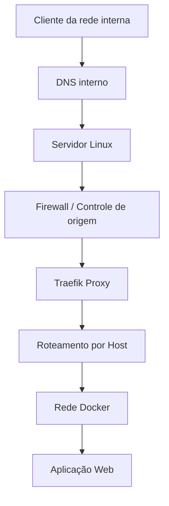

# Traefik Proxy Reverso Seguro


### Publicação centralizada de aplicações internas com Docker, DNS e controle de acesso por firewall.

<p align="center">
  <strong>Infraestrutura • Redes • Docker • Proxy Reverso • Segurança</strong>
</p>

---

## Sobre o projeto

Este projeto apresenta um estudo prático de implementação do **Traefik Proxy** como camada de proxy reverso para publicação centralizada de aplicações web em um ambiente Linux com Docker.

A iniciativa surgiu da necessidade de disponibilizar diferentes aplicações internas por meio de nomes DNS amigáveis, sem precisar expor diretamente uma porta web diferente para cada sistema.

Além da centralização do acesso, a segurança da conectividade foi tratada como requisito fundamental, com restrição de origens autorizadas, regras específicas de firewall e configuração de serviços com privilégios reduzidos.

O projeto foi desenvolvido com foco em simplicidade operacional, escalabilidade e facilidade de manutenção.

## Objetivos

- Centralizar a publicação de aplicações web internas.
- Utilizar nomes DNS para facilitar o acesso dos usuários.
- Encaminhar requisições automaticamente para os serviços de destino.
- Reduzir a exposição direta das aplicações.
- Controlar as origens autorizadas por meio de regras de firewall.
- Preparar a infraestrutura para utilização de HTTPS.
- Criar uma arquitetura que permita adicionar novas aplicações futuramente.

## Tecnologias utilizadas

| Tecnologia | Finalidade |
|---|---|
| Traefik Proxy v3 | Proxy reverso e roteamento HTTP |
| Docker Engine | Execução dos serviços em contêineres |
| Docker Compose | Gerenciamento declarativo dos serviços |
| Ubuntu Server | Sistema operacional do servidor |
| DNS interno | Resolução dos nomes das aplicações |
| iptables | Controle de tráfego na cadeia DOCKER-USER |
| UFW | Firewall do sistema operacional |
| YAML | Configuração estática, dinâmica e Docker Compose |

## Arquitetura da solução

O fluxo de comunicação foi estruturado para que o usuário acesse a aplicação pelo nome DNS, enquanto o Traefik identifica o destino e encaminha a requisição pela rede interna do Docker.



### Fluxo de funcionamento

1. O usuário acessa o endereço DNS da aplicação.
2. O DNS resolve o nome para o endereço do servidor.
3. O firewall verifica se a origem está autorizada.
4. O Docker encaminha a conexão para o contêiner Traefik.
5. O Traefik identifica a aplicação pelo cabeçalho HTTP `Host`.
6. A requisição é encaminhada para o serviço correspondente na rede Docker.
7. A aplicação processa a requisição e retorna a resposta ao usuário.

## Implementação

### 1. Implantação do Traefik

O Traefik foi implantado como um serviço independente no Docker Compose, com:

- Política de reinicialização automática.
- Limites de memória e CPU.
- Rotação de logs.
- Arquivos de configuração montados como somente leitura.
- Publicação da porta HTTP no endereço específico do host.
- Conexão à rede Docker compartilhada com as aplicações.

### 2. Configuração estática

O arquivo `traefik.yml` define os pontos de entrada e os provedores de configuração.

Exemplo simplificado:

```yaml
api:
  dashboard: false

entryPoints:
  web:
    address: ":80"

providers:
  file:
    directory: /etc/traefik/dynamic
    watch: true

log:
  level: INFO

accessLog: {}
```

O dashboard administrativo foi desativado e o provedor de arquivos foi escolhido para manter o controle explícito das rotas.

### 3. Configuração dinâmica

Cada aplicação pode possuir seu próprio arquivo de configuração.

Exemplo:

```yaml
http:
  routers:
    sistema:
      rule: "Host(`app.example.internal`)"
      entryPoints:
        - web
      service: sistema

  services:
    sistema:
      loadBalancer:
        servers:
          - url: "http://web-app:80"
```

O Traefik identifica o domínio solicitado e encaminha o tráfego para a porta em que a aplicação escuta na rede Docker. Neste exemplo, `web-app:80` usa a porta interna 80; essa porta varia conforme a aplicação. Ela é independente da porta publicada no host.

### 4. Integração com DNS

Foi utilizado um registro DNS do tipo A para associar o nome da aplicação ao endereço do servidor.

Exemplo fictício:

| Registro | Nome | Endereço |
|---|---|---|
| A | app.example.internal | 192.0.2.10 |

Validação:

```cmd
nslookup app.example.internal
```

### 5. Segurança e controle de acesso

A segurança da conectividade foi um dos principais pontos considerados na implantação.

As medidas adotadas incluem:

- Restrição de acesso às portas publicadas conforme as redes autorizadas.
- Utilização da cadeia `DOCKER-USER` para controlar o tráfego destinado aos serviços publicados pelo Docker.
- Preservação das regras de acesso SSH existentes.
- Dashboard do Traefik desativado.
- Ausência de montagem do socket Docker no contêiner do proxy.
- Arquivos de configuração montados como somente leitura.
- Limites de recursos para o contêiner.
- Publicação da porta vinculada ao endereço específico do servidor.

Comandos utilizados para inspeção:

```bash
sudo iptables -S DOCKER-USER
sudo iptables -vnL DOCKER-USER
sudo ufw status verbose
```

A configuração do firewall deve sempre considerar a ordem das regras e o caminho efetivo do tráfego Docker. As regras precisam ser adaptadas à topologia de cada ambiente.

## Diagnóstico e solução de problemas

Durante a implantação, ocorreu uma falha na inicialização do Traefik.

O log apresentava uma mensagem semelhante a:

```text
listen tcp 192.0.2.10:80: bind: cannot assign requested address
```

A causa foi a tentativa de utilizar o endereço IP do host como endereço de escuta dentro do contêiner.

A correção foi utilizar:

```yaml
entryPoints:
  web:
    address: ":80"
```

O endereço IP específico do host permaneceu configurado no mapeamento de portas do Docker Compose.

Após a correção, o contêiner permaneceu em execução e o encaminhamento HTTP foi validado.

Esse diagnóstico reforçou a importância de diferenciar o endereço de escuta interno do contêiner do endereço de publicação no host.

## Validação da solução

A validação foi dividida em etapas para identificar possíveis falhas de configuração, DNS, conectividade e roteamento.

### Validar Docker Compose

```bash
sudo docker compose -f /path/to/compose.yaml config -q
```

### Verificar o estado do Traefik

```bash
sudo docker ps --filter name=traefik
```

### Consultar logs

```bash
sudo docker logs --tail 80 traefik
```

### Testar o roteamento

```bash
curl -sS -D - -o /dev/null \
  -H 'Host: app.example.internal' \
  http://192.0.2.10/
```

No ambiente de implementação, a aplicação retornou:

```text
HTTP/1.1 307 Temporary Redirect
Location: /login
```

Esse resultado confirmou que o Traefik recebeu a requisição e a encaminhou corretamente para a aplicação web.

O acesso também foi validado pelo navegador utilizando o nome DNS interno, com a tela de autenticação sendo exibida.

## Resultados alcançados

- Proxy reverso Traefik implantado e operacional.
- Aplicação web publicada por nome DNS.
- Roteamento baseado no cabeçalho HTTP `Host` validado.
- Comunicação entre contêineres validada.
- Regras de firewall implementadas para restringir origens.
- Acesso administrativo do Traefik desativado.
- Diagnóstico e correção de falha de inicialização.
- Arquitetura preparada para inclusão de novas aplicações.

## Próximas etapas

A implementação inicial foi validada por HTTP. A evolução para HTTPS está planejada e ainda precisa ser concluída.

| Etapa | Situação |
|---|---|
| Implantação do Traefik | Concluída |
| Roteamento da primeira aplicação | Validado |
| Integração com DNS | Validada |
| Controle de acesso por firewall | Implementado |
| Emissão do certificado TLS | Pendente |
| Configuração do HTTPS | Pendente |
| Redirecionamento HTTP para HTTPS | Pendente |
| Publicação de aplicações adicionais | Planejada |

**Importante:** HTTP não criptografa credenciais ou dados de sessão em trânsito. A publicação HTTP deste estudo foi uma etapa temporária, limitada às origens autorizadas. O uso definitivo deverá ocorrer após a implantação e validação do HTTPS.

## Aprendizados técnicos

Este projeto proporcionou experiência prática em:

- Administração de ambientes Linux.
- Implantação e gerenciamento de contêineres Docker.
- Configuração de proxy reverso com Traefik.
- Roteamento HTTP baseado em domínio.
- Integração com DNS interno.
- Administração de firewall com UFW e iptables.
- Segurança de portas publicadas pelo Docker.
- Diagnóstico de falhas de rede e inicialização.
- Documentação e validação de infraestrutura.

## Considerações finais

A implementação demonstrou como o Traefik pode simplificar a publicação de aplicações internas, centralizando o roteamento e mantendo o controle sobre a conectividade.

Mais do que disponibilizar uma aplicação, o objetivo foi estabelecer uma base de infraestrutura organizada, segura e preparada para crescimento.

**Princípio adotado durante o projeto: publicar somente o necessário, restringir quem pode conectar e validar cada camada antes de ampliar o acesso.**

---

*Projeto de estudo de caso desenvolvido a partir de uma implementação prática de infraestrutura. Nomes, endereços IP, domínios e demais informações operacionais foram generalizados para preservar a confidencialidade do ambiente original.*

