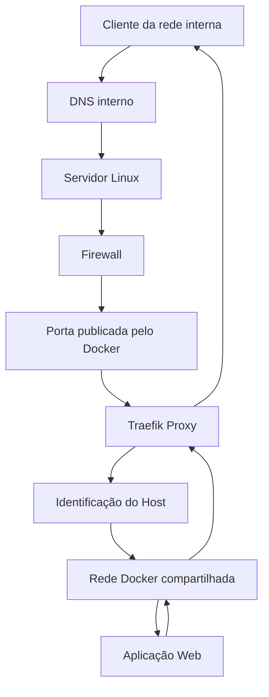

# Arquitetura da Solução — Proxy Reverso com Traefik

## 1. Visão geral

A arquitetura utiliza o Traefik como ponto central de entrada para aplicações web hospedadas em contêineres Docker.

O objetivo é permitir que diferentes aplicações sejam acessadas por nomes DNS específicos, mantendo um único ponto de publicação HTTP/HTTPS no servidor.

O Traefik recebe as requisições, identifica o domínio solicitado e encaminha o tráfego para o serviço correspondente na rede Docker.

A arquitetura foi planejada para permitir a inclusão de novas aplicações sem a necessidade de publicar diretamente uma porta web diferente para cada sistema.

## 2. Diagrama da arquitetura



## 3. Componentes da arquitetura

| Componente | Responsabilidade |
|---|---|
| Cliente | Realizar o acesso à aplicação pelo navegador |
| DNS interno | Resolver o nome da aplicação para o IP do servidor |
| Servidor Linux | Hospedar o Docker Engine e os serviços |
| Firewall | Controlar as origens autorizadas |
| Docker Engine | Executar e interconectar os contêineres |
| Traefik | Receber e encaminhar as requisições |
| Rede Docker | Permitir a comunicação entre proxy e aplicações |
| Aplicação Web | Processar as requisições dos usuários |

## 4. Fluxo de comunicação

O processo de acesso ocorre nas seguintes etapas:

1. O usuário informa no navegador o endereço DNS da aplicação.
2. O cliente consulta o DNS interno.
3. O DNS retorna o endereço IP do servidor que hospeda o proxy reverso.
4. A conexão chega ao servidor pela porta publicada.
5. O firewall verifica as regras de acesso aplicáveis à origem.
6. O Docker encaminha a conexão para o contêiner Traefik.
7. O Traefik analisa o cabeçalho HTTP `Host`.
8. O proxy identifica a regra correspondente ao domínio solicitado.
9. A requisição é encaminhada para a aplicação de destino na rede Docker.
10. A aplicação processa a solicitação e retorna a resposta através do proxy.

## 5. Roteamento baseado em domínio

O Traefik utiliza regras de roteamento para identificar qual aplicação deve receber determinada requisição.

Exemplo:

```yaml
http:
  routers:
    sistema:
      rule: "Host(`app.example.internal`)"
      entryPoints:
        - web
      service: sistema

  services:
    sistema:
      loadBalancer:
        servers:
          - url: "http://web-app:8080"
```

Nesse exemplo:

- `app.example.internal` representa o domínio utilizado pelo usuário.
- `web` identifica o ponto de entrada HTTP.
- `sistema` identifica o serviço configurado no Traefik.
- `web-app:8080` representa o destino interno na rede Docker.

O endereço do serviço é resolvido pela rede Docker compartilhada entre o proxy e a aplicação.

## 6. Organização das redes

A comunicação entre os contêineres ocorre por meio de uma rede Docker apropriada.

Essa organização permite que o Traefik acesse os serviços internos sem exigir que cada aplicação publique sua porta web diretamente no host.

Exemplo conceitual:

```text
                 Rede Docker
                      |
          +-----------+-----------+
          |                       |
     +---------+             +----------+
     | Traefik | ----------> | Web App  |
     +---------+             +----------+
          |
          |
     Entrada HTTP/HTTPS
```

O acesso entre os contêineres deve ser limitado aos serviços que realmente precisam se comunicar.

## 7. Segurança da arquitetura

A segurança foi considerada desde o desenho da solução.

As principais medidas incluem:

- Controle de acesso às portas publicadas.
- Restrição de origens por regras de firewall.
- Utilização da cadeia `DOCKER-USER` para controle
