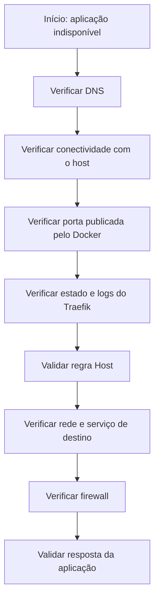

# Troubleshooting — Diagnóstico e Resolução de Problemas com Traefik

## 1. Introdução

Durante a implantação de um proxy reverso, diferentes camadas da infraestrutura precisam funcionar corretamente: sistema operacional, Docker, rede, DNS, firewall, proxy e aplicação de destino.

Uma falha em qualquer uma dessas camadas pode impedir o acesso ao serviço, mesmo quando os demais componentes estão operacionais.

Este documento reúne os principais problemas identificados durante a implantação do Traefik, os procedimentos de investigação utilizados e as soluções aplicadas.

Os exemplos utilizam nomes, endereços IP e domínios fictícios para preservar a confidencialidade do ambiente original.

## 2. Problema: Traefik entra em ciclo de reinicialização

### Sintoma

Após iniciar o contêiner, o comando `docker ps` apresentava o Traefik com status semelhante a:

```text
NAMES     STATUS
traefik   Restarting (1)
```

O contêiner não permanecia em execução.

### Investigação

O primeiro passo foi consultar os logs:

```bash
sudo docker logs --tail 100 traefik
```

A mensagem identificada foi semelhante a:

```text
ERR Command error error="command traefik error:
error while building entryPoint web:
building listener:
error opening listener:
listen tcp 10.20.30.40:80:
bind: cannot assign requested address"
```

### Causa identificada

O Traefik estava configurado para escutar diretamente no endereço IP do host dentro do contêiner.

Entretanto, o endereço IP do servidor não estava atribuído a uma interface de rede do próprio contêiner.

Essa diferença entre o endereço do host e o endereço de escuta interno provocava a falha na inicialização do entrypoint.

### Solução aplicada

A configuração foi alterada para:

```yaml
entryPoints:
  web:
    address: ":80"
```

O endereço IP específico do servidor permaneceu configurado no mapeamento de portas do Docker Compose.

Exemplo:

```yaml
ports:
  - "10.20.30.40:80:80"
```

### Resultado

Após a correção:

- O Traefik iniciou normalmente.
- O contêiner permaneceu em execução.
- A porta HTTP ficou publicada no endereço configurado do host.
- Foi possível prosseguir com os testes de roteamento.

### Aprendizado

É fundamental distinguir o endereço de escuta de um serviço dentro do contêiner do endereço utilizado para publicar uma porta no host.

---

## 3. Problema: conexão recusada ao utilizar localhost

### Sintoma

Durante um teste local, foi executado:

```bash
curl http://127.0.0.1/
```

O resultado foi semelhante a:

```text
curl: (7) Failed to connect to 127.0.0.1 port 80:
Could not connect to server
```

### Investigação

O serviço Traefik estava em execução, mas sua porta publicada estava vinculada especificamente ao endereço IP do host.

Exemplo:

```text
10.20.30.40:80 -> 80/tcp
```

Isso significa que a publicação foi realizada no endereço específico do servidor, e não no endereço de loopback `127.0.0.1`.

### Solução

O teste foi realizado utilizando o endereço IP efetivamente configurado para publicação:

```bash
curl http://10.20.30.40/
```

Para testar também o roteamento por domínio, foi utilizado o cabeçalho `Host`.

```bash
curl -sS -D - -o /dev/null --max-time 5 \
  -H 'Host: app.example.internal' \
  http://10.20.30.40/
```

### Resultado

A requisição chegou à aplicação e retornou:

```text
HTTP/1.1 307 Temporary Redirect
Location: /login
```

### Aprendizado

Uma falha de conexão em `localhost` não significa necessariamente que o serviço esteja indisponível.

É necessário verificar em qual endereço IP a porta foi publicada e realizar o teste utilizando o endpoint correto.

---

## 4. Problema: aplicação acessível pelo IP, mas não pelo domínio

### Sintoma

A aplicação responde quando acessada diretamente pelo endereço IP, mas não funciona utilizando o nome DNS.

### Investigação

Esse cenário pode envolver problemas de resolução DNS, configuração do router ou cabeçalho `Host`.

A investigação deve ser dividida em etapas.

### Etapa 1 — verificar o DNS

No Windows:

```cmd
nslookup app.example.internal
```

O resultado deve apresentar o endereço IP esperado do servidor.

### Etapa 2 — testar a porta publicada

```bash
curl -v --max-time 5 http://10.20.30.40/
```

### Etapa 3 — testar o cabeçalho Host

```bash
curl -sS -D - -o /dev/null \
  -H 'Host: app.example.internal' \
  http://10.20.30.40/
```

### Etapa 4 — verificar a configuração dinâmica

```bash
sudo cat /etc/traefik/dynamic/web-app.yml
```

Confira:

- Se o domínio da regra `Host` está correto.
- Se o entrypoint corresponde ao configurado.
- Se o nome do serviço está correto.
- Se a porta interna corresponde à aplicação.

### Possíveis causas

- Registro DNS inexistente ou incorreto.
- Cliente consultando outro servidor DNS.
- Regra `Host` diferente do domínio utilizado.
- Arquivo dinâmico com erro de sintaxe.
- Aplicação não conectada à rede Docker compartilhada.
- Porta interna incorreta.

### Aprendizado

DNS e roteamento são mecanismos diferentes. A resolução correta do domínio não garante que o Traefik possua uma rota válida para aquela aplicação.

---

## 5. Problema: Traefik em execução, mas aplicação de destino indisponível

### Sintoma

O contêiner Traefik permanece ativo, mas a aplicação não responde corretamente através do proxy.

### Investigação

Primeiro, verifique se a aplicação está em execução:

```bash
sudo docker ps
```

Depois, confira as redes:

```bash
sudo docker network inspect proxy-net
```

Verifique se o Traefik e a aplicação estão conectados à rede apropriada.

Também é importante testar o serviço diretamente de dentro do contêiner Traefik, quando houver uma ferramenta HTTP disponível:

```bash
sudo docker exec traefik \
  wget -S -O - http://web-app:8080/
```

Se o utilitário `wget` não estiver instalado na imagem, utilize um contêiner temporário de diagnóstico conectado à mesma rede Docker.

### Possíveis causas

- Aplicação parada.
- Porta interna incorreta.
- Nome do serviço incorreto.
- Contêineres sem conectividade pela rede Docker.
- Aplicação escutando apenas em uma interface inadequada.
- Configuração incorreta do destino no arquivo dinâmico.

### Aprendizado

O fato de o proxy estar operacional não garante que os serviços de destino estejam acessíveis. A conectividade entre contêineres deve ser validada separadamente.

---

## 6. Problema: firewall bloqueando o acesso à aplicação

### Sintoma

O DNS resolve corretamente, o Traefik está em execução, mas determinados clientes não conseguem acessar a aplicação.

### Investigação

Verifique as regras da cadeia `DOCKER-USER`:

```bash
sudo iptables -S DOCKER-USER
```

Consulte também os contadores:

```bash
sudo iptables -vnL DOCKER-USER
```

E o estado do UFW:

```bash
sudo ufw status verbose
```

### Pontos de atenção

- A origem do cliente está em uma rede autorizada?
- A regra de permissão está antes da regra de bloqueio?
- A porta original de destino está correta?
- As regras estão sendo aplicadas à cadeia apropriada?
- A persistência do firewall está funcionando?

### Solução

Ajustar as regras conforme a política de acesso definida, preservando as permissões administrativas existentes.

As alterações devem ser realizadas com backup das regras atuais e plano de rollback.

### Aprendizado

A publicação de uma porta pelo Docker exige compreender o fluxo de encaminhamento de pacotes. Não se deve presumir que uma regra convencional de entrada do UFW controla, isoladamente, todo o tráfego destinado a contêineres.

---

## 7. Problema: alterações nas configurações não produzem o resultado esperado

### Sintoma

Uma rota foi alterada, mas o comportamento observado continua diferente do esperado.

### Investigação

Confira os arquivos utilizados pelo provedor de arquivos:

```bash
sudo ls -la /etc/traefik/dynamic/
```

Consulte o conteúdo da configuração:

```bash
sudo cat /etc/traefik/dynamic/web-app.yml
```

Verifique os logs:

```bash
sudo docker logs --since 10m traefik
```

### Possíveis causas

- Arquivo salvo em diretório incorreto.
- Erro de indentação YAML.
- Regra `Host` incorreta.
- Serviço de destino incorreto.
- Alteração realizada em arquivo diferente do montado no contêiner.

### Aprendizado

A organização das configurações e a separação entre arquivos estáticos e dinâmicos facilitam a manutenção e a investigação de problemas.

---

## 8. Método de diagnóstico utilizado

Durante a implantação, a investigação foi conduzida de maneira incremental, isolando cada camada.

A sequência recomendada é:



A sequência pode ser adaptada conforme o sintoma. Por exemplo, quando o contêiner está em ciclo de reinicialização, a análise dos logs deve vir antes dos testes de DNS.

## 9. Comandos de referência

| Objetivo | Comando |
|---|---|
| Verificar contêineres | `sudo docker ps` |
| Consultar logs | `sudo docker logs --tail 100 traefik` |
| Consultar logs recentes | `sudo docker logs --since 10m traefik` |
| Verificar portas publicadas | `sudo docker port traefik` |
| Inspecionar redes | `sudo docker network ls` |
| Inspecionar uma rede | `sudo docker network inspect proxy-net` |
| Verificar regras Docker | `sudo iptables -S DOCKER-USER` |
| Consultar contadores | `sudo iptables -vnL DOCKER-USER` |
| Validar DNS | `nslookup app.example.internal` |
| Validar rota | `curl -v -H 'Host: app.example.internal' http://10.20.30.40/` |
| Validar Compose | `sudo docker compose -f /path/to/compose.yaml config -q` |

## 10. Boas práticas para troubleshooting

- Não reiniciar todos os contêineres sem identificar a origem da falha.
- Consultar os logs antes de alterar configurações.
- Isolar DNS, conectividade, proxy e aplicação durante os testes.
- Verificar os endereços e portas efetivamente publicados pelo Docker.
- Preservar o acesso administrativo durante alterações no firewall.
- Fazer backup antes de mudanças estruturais.
- Validar a sintaxe dos arquivos antes de aplicar alterações.
- Registrar a causa raiz e a solução aplicada.
- Evitar publicar logs que contenham informações internas ou dados sensíveis.

## 11. Conclusão

A implantação do Traefik demonstrou que o diagnóstico de problemas em ambientes conteinerizados exige análise conjunta de sistema operacional, Docker, rede, DNS, firewall e aplicação.

A falha inicial de bind e a diferença entre o endereço de loopback e o endereço específico de publicação foram exemplos práticos da importância de compreender como os componentes interagem.

O método incremental de investigação permitiu identificar e corrigir os problemas sem modificar desnecessariamente os demais serviços.

**Uma boa solução de infraestrutura não depende apenas de saber configurar: depende também de saber investigar, identificar a causa raiz e validar a correção.**

---

*Documento técnico de estudo de caso. Nomes, endereços IP, domínios e demais detalhes operacionais foram generalizados para preservar a confidencialidade do ambiente original.*
